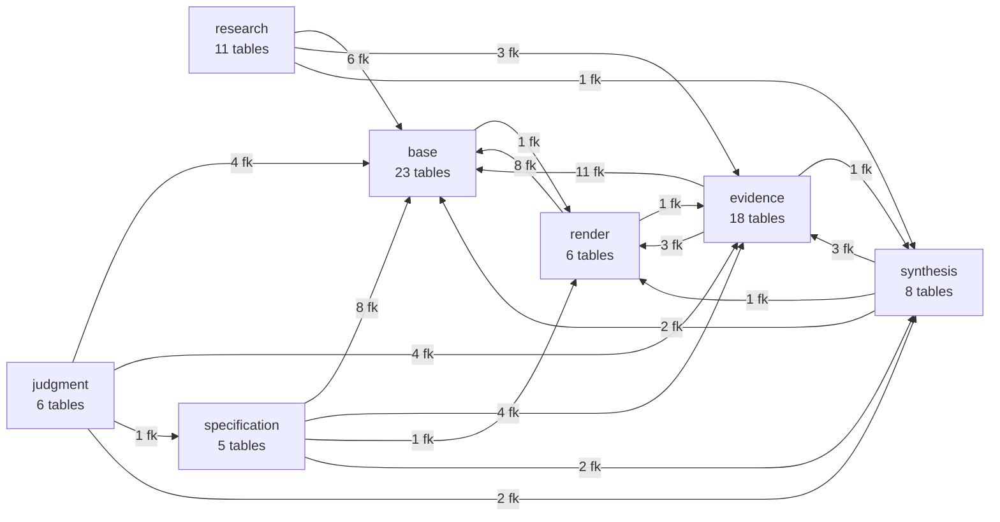
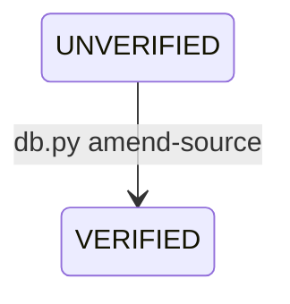
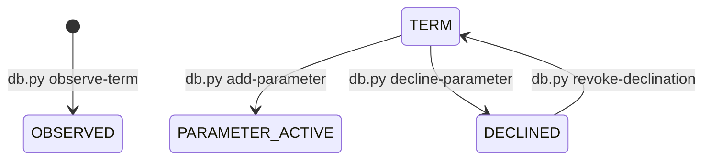
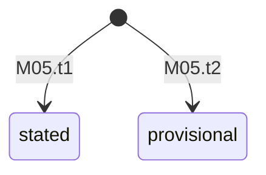
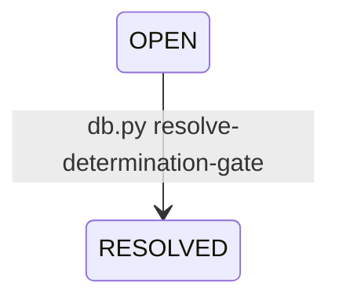
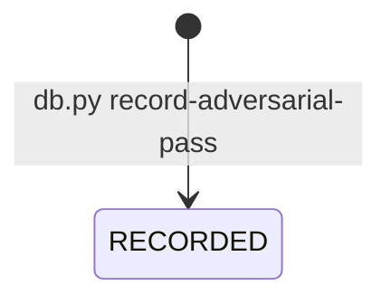
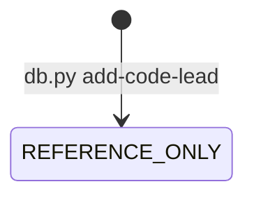
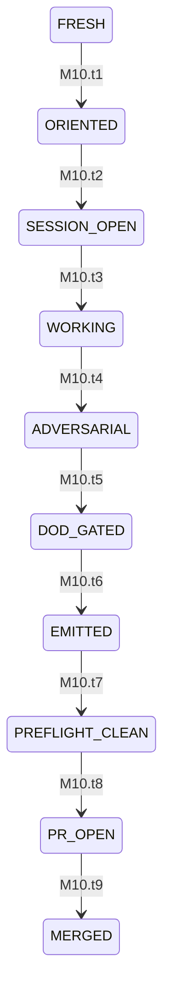

# Pipeline state graph

_GENERATED by `build_graph.py` -- do not edit. Generated 2026-10-14 03:59 UTC from git HEAD d3290e6 (working tree, uncommitted changes included). Re-run rather than trust any number below (CLAUDE.md rule 7a)._

Source tree: `/home/user/guidebook` at schema version `106`.

## 1. The spine, and what each stage holds

`SPINE: base -> research -> evidence -> judgment -> synthesis -> specification -> render`  (derived from `governance/pipeline-contract.yaml`; checked against `CLAUDE.md`)

| stage | tables | rows | empty tables | tables no db.py verb writes |
|---|---|---|---|---|
| base | 23 | 2995 | 5 | 14 |
| research | 11 | 1525 | 4 | 3 |
| evidence | 18 | 460 | 11 | 8 |
| judgment | 6 | 132 | 4 | 3 |
| synthesis | 8 | 150 | 5 | 3 |
| specification | 5 | 198 | 1 | 3 |
| render | 6 | 5 | 5 | 6 |
| infrastructure | 7 | 744 | 2 | 3 |

## 2. Stage graph (arrow = child table's foreign key points at the parent stage)



Cross-stage FKs are the pointers (CLAUDE.md rule 5). Count by direction:

| child stage | points at | FKs |
|---|---|---|
| base | render | 1 |
| evidence | base | 11 |
| evidence | render | 3 |
| evidence | synthesis | 1 |
| judgment | base | 4 |
| judgment | evidence | 4 |
| judgment | specification | 1 |
| judgment | synthesis | 2 |
| render | base | 8 |
| render | evidence | 1 |
| research | base | 6 |
| research | evidence | 3 |
| research | synthesis | 1 |
| specification | base | 8 |
| specification | evidence | 4 |
| specification | render | 1 |
| specification | synthesis | 2 |
| synthesis | base | 2 |
| synthesis | evidence | 3 |
| synthesis | render | 1 |

### 2a. Forward-pointing foreign keys (earlier stage's table -> later stage's table)

Pointers are meant to run from a later stage back to an earlier one (CLAUDE.md rule 5; re-entrancy, CLAUDE.md section 3, allows a walk to come back). These run the other way. A row count of 0 on the child means the dependency is structural only.

| foreign key | child stage | parent stage | child rows |
|---|---|---|---|
| case_study_specs.item_code -> items | evidence | render | 0 |
| citation_population_links.citation_id -> reasoning_doc_citations | judgment | synthesis | 0 |
| conflicts.item_code -> items | synthesis | render | 0 |
| economics_entry_specs.item_code -> items | evidence | render | 0 |
| evidence_population_match.gap_id -> gaps | judgment | synthesis | 54 |
| gap_mining.gap_id -> gaps | research | synthesis | 0 |
| jurisdictional_values.item_code -> items | evidence | render | 0 |
| probe_population_links.probe_id -> spec_value_probes | judgment | specification | 0 |
| room_items.item_code -> items | base | render | 0 |
| search_admissions.ref_id -> evidence_sources | research | evidence | 55 |
| search_candidates.resolved_ref_id -> evidence_sources | research | evidence | 147 |
| search_executions.mined_ref_id -> evidence_sources | research | evidence | 191 |
| source_value_extractions.promoted_to_rdc_id -> reasoning_doc_citations | evidence | synthesis | 101 |
| spec_value_probes.item_code -> items | specification | render | 0 |

## 3. State machines (hand-verified transitions; vocabularies derived from each column's own CHECK)

### M01 Staged search candidate  _(stage: research)_

State holder: `search_candidates.disposition`

```mermaid
stateDiagram-v2
```

| edge | from | to | via | guards / claim | evidence |
|---|---|---|---|---|---|
| M01.t1 | (none) | any state | db.py add-candidate | exec_id, if given, names a live search_executions row (a candidate is something a SEARCH surfaced); found_under_slug is a live slug; disposition is in the column's own CHECK; REHOME needs a valid destination slug (_check_rehome_destination); ADMITTED requires locator_status = RESOLVED (R15: a staged description is a hypothesis) | scripts/db.py::insert_search_candidate; scripts/db.py::insert_search_candidate; scripts/db.py::insert_search_candidate |
| M01.t2 | any state | any state | db.py resolve-candidate | a non-blank re-description FROM THE SOURCE (R15); the hypothesis is appended to, never overwritten; ADMITTED needs --admitted-ref-id naming an existing evidence_sources row; the edge is written to resolved_ref_id; --suggested-slug only with REHOME | scripts/db.py::resolve_candidate; scripts/db.py::resolve_candidate; scripts/db.py::resolve_candidate |
| M01.t3 | any state | any state | db.py resolve-candidate | NO from-state guard: ADMITTED -> OUT-OF-SCOPE (or any other move) is accepted. There is no verb that deletes a candidate. | scripts/db.py::resolve_candidate (absent) |

_Note: EXHAUSTED and PENDING-VERIFICATION are reachable only as a chosen value; no rule moves a row into or out of them (LED-185 is a convention)._

### M02 Admitted source -- verification, supersession  _(stage: evidence)_

State holder: `evidence_sources.verification_status`  ·  probe `P-STATUS-WRITERS` = **FAIL**



| edge | from | to | via | guards / claim | evidence |
|---|---|---|---|---|---|
| M02.t1 | (none) | NULL \| VERIFIED \| UNVERIFIED | db.py add-source | a duplicate DOI is refused and the existing ref_id cross-filed (R9); the source is admitted to at least one live slug (source_slug_links); NULL is representable, but R10 forbids leaving it on a URL-bearing source (the scheduled URL cron claims that pool) | scripts/db.py::insert_evidence_source; scripts/db.py::_check_slug_filable |
| M02.t2 | UNVERIFIED | VERIFIED | db.py amend-source (and the scheduled resolve-dois / verify-urls workflows, which bypass migrations) | the field is in _AMENDABLE; leaving verification_disposition='CLOSED' over a non-VERIFIED row is refused | scripts/db.py::amend_source; .github/workflows/resolve-dois.yml; .github/workflows/verify-urls.yml |
| M02.t3 | live | tombstone (superseded_by_ref_id set) | db.py supersede-source | both rows admitted; A != B; neither already superseded; no chains; refused while a LIVE determination rests on A through specification_source_links or convergence_sources (NOT specification_extraction_links: step 0.3 found the hole) (retire the specification first); a blank reason is refused; NO un-supersede verb exists | scripts/db.py::supersede_source; scripts/db.py::supersede_source; scripts/db.py::supersede_source |
| M02.t4 | pending | mined \| deferred \| not-applicable | db.py log-mining | a deferral over a 'mined' source is refused unless --status is passed | scripts/db.py::log_mining |
| M02.t5 | pending | captured | db.py add-extraction \| derive-extraction | data_capture_status: pending -> captured, written by add-extraction / derive-extraction in the same transaction (a cross-stage write, judgment -> evidence); never moves back. | scripts/db.py::insert_extraction |

_Note: data_capture_status 'none-extractable' and 'deferred' have no writer on main (PRC/OPS-04 require a status column to ship with its writer)._

### M03 Vocabulary growth -- observed phrase to parameter  _(stage: evidence -> judgment -> base)_

State holder: `observed_terms -> term_adjudications -> terms -> base_parameters | parameter_declinations`  ·  probe `P-PARAM-LIFECYCLE` = **PASS**



| edge | from | to | via | guards / claim | evidence |
|---|---|---|---|---|---|
| M03.t1 | (none) | OBSERVED | db.py observe-term | accepts NO term_id (an observation is unjudged); the source is admitted and not a tombstone; one row per (ref, surface form, language) | scripts/db.py::observe_term; scripts/db.py::observe_term |
| M03.t2 | OBSERVED | ADJUDICATED-* | db.py adjudicate-term | a rationale is required; NAMES-* needs a term_id that exists; NOT-OURS and DEFERRED must carry none; divergent adjudications are DELIBERATELY allowed (no uniqueness on observation_id) -- a contest, not an error | scripts/db.py::adjudicate_term; scripts/db.py::adjudicate_term |
| M03.t3 | OBSERVED | TERM + ADJUDICATED-NAMES-NEW (one act) | db.py add-term --from-observation | a canonical name carrying a digit, comparator or min/max word is refused (the container may not state its answer); a name that already exists is refused and pointed at NAMES-EXISTING; a term can only be minted FROM an observation | scripts/db.py::insert_term; scripts/db.py::insert_term |
| M03.t4 | TERM | PARAMETER-ACTIVE | db.py add-parameter | refused for a DECLINED term; refused for a value-bearing name; one parameter per term; DELIBERATELY NOT refused: a term with no adjudication (the base vocabulary predates observe/adjudicate); created active; there is no --status and no --merged-into | scripts/db.py::insert_parameter; scripts/db.py::insert_parameter; scripts/db.py::insert_parameter |
| M03.t5 | TERM | DECLINED | db.py decline-parameter | refused if the term is already a parameter of ANY status; one declination per term; a reason is required; reversing one is `revoke-declination` (migration 104): a recorded decision, the row stays | scripts/db.py::decline_parameter; scripts/db.py::decline_parameter |
| M03.t5r | DECLINED | TERM | db.py revoke-declination | a reason and a resolving decision reference are required; refused for a term with no declination or one already revoked; the row is retired in place (revoked_at, revoked_by_session, revocation_reason); one declination per term, so a revoked one cannot be followed by a second | scripts/db.py::revoke_declination; scripts/db.py::revoke_declination |
| M03.t6 | PARAMETER-ACTIVE | merged \| retired | db.py retire-parameter \| db.py merge-parameter | retire-parameter refuses a parameter that is not active, and a live determination or open gate on it; merge-parameter re-points every row that holds the folded id, read from the live foreign keys | scripts/db.py::retire_parameter; scripts/db.py::merge_parameter |

### M04 Captured value (source_value_extractions)  _(stage: judgment)_

State holder: `source_value_extractions.extraction_status`  ·  probe `P-V2` = **FAIL**

```mermaid
stateDiagram-v2
```

| edge | from | to | via | guards / claim | evidence |
|---|---|---|---|---|---|
| M04.t1 | (none) | preliminary (default) \| any value passed | db.py add-extraction | the source is admitted and not a tombstone; the source is admitted to the NAMED slug (source_slug_links) -- ref<->slug coherence, NOT parameter<->slug; parameter_id required, parameter exists and is ACTIVE; at least one lens column, and that lens code must exist in its registry table; a claim_text is required; claim_type 'absent' carries no value and must be figure_role 'finding'; a value from a tier >= 4 source needs a structured locator or [UNVERIFIED-QUANT]; figure_role is required; --relation is required ('none' or edges); 'derived' needs a derived_from base edge | scripts/db.py::insert_extraction; scripts/db.py::insert_extraction; scripts/db.py::insert_extraction; scripts/db.py::insert_extraction; scripts/db.py::insert_extraction; scripts/db.py::insert_extraction |
| M04.t2 | any | any (extraction_method, extraction_status, figure_role, comparator, root_type, root_ref_id only) | db.py amend-extraction | a changed claimed_value or claim_text is NOT amendable: it is a second row and a contest (D-0168) | scripts/db.py |
| M04.t3 | (none) | preliminary \| ... | db.py derive-extraction | the base figure must already be extracted (add-extraction first); a derived row without a base is refused | scripts/db.py::derive_extraction |

_Note: No verb deletes an extraction. Which of reviewed / verified / contradicted / absent-confirmed may set a published value is OPEN (LED-202)._

### M05 Determination (specifications)  _(stage: specification)_

State holder: `specifications.state`  ·  probe `P-ENG-STATE` = **FAIL**



| edge | from | to | via | guards / claim | evidence |
|---|---|---|---|---|---|
| M05.t1 | (none) | stated | scripts/assess/assess_cell.py --emit-sql -> emit_batch_sql -> emit_data_migration -> migrate_db | at least one anchoring source among T1 / Co-1 / T2 / Co-2 that survived the anchoring gates (B5a tier derivability, non-anchoring conditioning); governing_refs non-empty | scripts/assess/assess_cell.py::determine; scripts/assess/assess_cell.py::determine |
| M05.t2 | (none) | provisional | assess_cell.determine | T3-clinical is the only anchoring axis (tier3-stated-threshold DR, 2026-07-12); or: a derivation-handshake gate BINDS on a cell that would be stated (the cap); the gate id is not copied onto the row; or: a regulatory-stratum-only basis (a floor claim, never best practice) | scripts/assess/assess_cell.py::determine; scripts/assess/assess_cell.py::determine |
| M05.t3 | (none) | pending (+ a gap row) | assess_cell.determine | no extraction for this parameter, or every holder is disqualified, or every one failed the tier gate; or: T3-grey is the only evidence (does not even reach provisional) | scripts/assess/assess_cell.py::determine; scripts/assess/assess_cell.py::determine |
| M05.t4 | live | retired (row stays as history) | db.py retire-specification | a reason is required (a trigger also refuses a retirement without one); retired twice is refused; --superseded-by may fill an empty pointer later; a determination is superseded once; the replacement does not exist at retirement: the order is retire, re-determine, then link | scripts/db.py::retire_specification; scripts/db.py::retire_specification |
| M05.t5 | any | not_applicable | (none) | 'not_applicable' has NO producer on main: the engine never assigns it (only a NULL not_applicable_rationale is written). The documented 'any -> not_applicable' edge (EVI-361) is therefore not realised. | scripts/assess/assess_cell.py::determine (absent) |
| M05.t6 | any | any | retire-specification then assess_cell | The engine stores no from-state: a state change is retire + re-determine, so the documented transition table (EVI-361/364) is not enforced as a relation. | scripts/db.py::retire_specification |

### M06 Determination gate  _(stage: specification)_

State holder: `determination_gates (resolved_at IS NULL | NOT NULL)`



| edge | from | to | via | guards / claim | evidence |
|---|---|---|---|---|---|
| M06.t1 | (none) | OPEN (verdict UNLINKED \| MISLINKED \| UNDER-CONSERVATIVE \| CONTRADICTS) | db.py raise-determination-gate | verdict is in the column's own CHECK; the row carries identity_code only (P-GT) | scripts/db.py::raise_determination_gate |
| M06.t2 | OPEN | RESOLVED | db.py resolve-determination-gate | a rationale is required | scripts/db.py::resolve_determination_gate |

### M07 Gap  _(stage: synthesis)_

State holder: `gaps.status`

| edge | from | to | via | guards / claim | evidence |
|---|---|---|---|---|---|
| M07.t1 | (none) | OPEN | db.py add-gap \| assess_cell (INSERT INTO gaps when gap_needed) |  | scripts/assess/assess_cell.py; scripts/db.py::insert_gap |
| M07.t2 | OPEN | CLOSED | db.py close-gap |  | scripts/db.py::close_gap |

_Note: status is constrained only by LIKE 'OPEN%' / LIKE 'CLOSED%'; the sub-vocabulary after the prefix is free text._

### M08 Adversarial pass and its findings  _(stage: process)_

State holder: `adversarial_passes.closed_at; adversarial_findings.disposition`



| edge | from | to | via | guards / claim | evidence |
|---|---|---|---|---|---|
| M08.t1 | (none) | RECORDED | db.py record-adversarial-pass |  | scripts/db.py::record_adversarial_pass |
| M08.t2 | RECORDED | DISPOSED (REPAIRED \| REJECTED \| PROVISIONAL-DISPUTED \| OWNER-RULED) | db.py dispose-adversarial-finding | REPAIRED needs --ref to be a real repair; OWNER-RULED needs --ref naming the ruling | scripts/db.py::dispose_adversarial_finding; scripts/db.py::dispose_adversarial_finding |
| M08.t3 | RECORDED (disposed or not) | CLOSED | db.py close-adversarial-pass | every lens in the column's own CHECK has a finding row (a NOT-ATTACKED row counts as covering its lens if its method says why); at least one row is SURVIVED (a zero-finding pass must be able to show what it tried); every SURVIVED row names an artefact that exists; it does NOT read `disposition`: a finding need not be disposed before the pass closes | scripts/db.py::close_adversarial_pass; scripts/db.py::close_adversarial_pass; scripts/db.py::close_adversarial_pass (absent); scripts/db.py::close_adversarial_pass |

### M09 Code lead (clue store)  _(stage: research)_

State holder: `research_code_leads.status`



| edge | from | to | via | guards / claim | evidence |
|---|---|---|---|---|---|
| M09.t1 | (none) | REFERENCE-ONLY | db.py add-code-lead |  | scripts/db.py::insert_code_lead |
| M09.t2 | REFERENCE-ONLY | RETRIEVED \| SUPERSEDED | db.py update-code-lead |  | scripts/db.py::update_code_lead |

### M10 Research batch / session (process machine)  _(stage: process)_

State holder: `scratchpad/CURRENT + the session record`



| edge | from | to | via | guards / claim | evidence |
|---|---|---|---|---|---|
| M10.t1 | FRESH | ORIENTED | bash .claude/hooks/ensure-deps.sh; /orient | ensure-deps exits 0 on failure by design, so the install is checked before any red result is believed | CLAUDE.md; .claude/commands/orient.md |
| M10.t2 | ORIENTED | SESSION-OPEN | /session-open (creates the batch folder and sets scratchpad/CURRENT) | CURRENT holds the DB session stem; the scratchpad folder is named identically | .claude/commands/session-open.md |
| M10.t3 | SESSION-OPEN | WORKING | scratch DB copy + db.py verbs (GUIDEBOOK_DB_PATH inline on every call) | the canonical DB's sha256 must not move until the migration is applied | CLAUDE.md |
| M10.t4 | WORKING | ADVERSARIAL | /adversarial (at most one pass per batch; no pass on a pass; no remediation scheduling) |  | .claude/commands/adversarial.md |
| M10.t5 | ADVERSARIAL | DOD-GATED | /batch-done (research_batch_dod, adversarial_pass_audit, search_log_completeness on CURRENT) | the session id is the bare stem in the DB and carries .md in pointer files; the wrong form scopes the gate to zero rows | .claude/commands/batch-done.md |
| M10.t6 | DOD-GATED | EMITTED | scripts/research/emit_batch_sql.py -> scripts/emit_data_migration.py -> scripts/migrate_db.py | a data migration is append-only and immutable once committed; fix forward | CLAUDE.md |
| M10.t7 | EMITTED | PREFLIGHT-CLEAN | scripts/preflight.sh; run_checks.py --changed-from origin/main --explain; --selftest after any rename | run once, when the diff is ready -- not after every edit | CLAUDE.md |
| M10.t8 | PREFLIGHT-CLEAN | PR-OPEN | create_pull_request, then unsubscribe_pr_activity immediately | no subscribe_pr_activity, no send_later, no create_trigger; the final push is never [skip ci] | CLAUDE.md |
| M10.t9 | PR-OPEN | MERGED | the owner | a research PR follows the tooling-only PR (rule 10); if the PR merges mid-session, CURRENT and the folder are moved together | CLAUDE.md |

## 4. Table inventory (derived)

| table | stage | rows | db.py verbs that write it | lens / population columns | flags |
|---|---|---|---|---|---|
| access_duration | base | 3 | -- | -- | NO-WRITER |
| access_need_axis_map | base | 21 | -- | -- | NO-WRITER |
| access_need_icf | base | 43 | -- | icf_code | NO-WRITER |
| access_needs | base | 17 | -- | -- | NO-WRITER |
| access_stakes | base | 3 | -- | -- | NO-WRITER |
| adversarial_findings | infrastructure | 88 | record-adversarial-pass, dispose-adversarial-finding | -- |  |
| adversarial_passes | infrastructure | 4 | record-adversarial-pass, close-adversarial-pass | -- |  |
| axes | base | 17 | -- | -- | NO-WRITER |
| base_icf | base | 72 | add-icf-code, set-icf-title | icf_code |  |
| base_parameters | base | 10 | set-parameter-direction, add-parameter, retire-parameter, merge-parameter, annotate-parameter | -- |  |
| base_taxonomy_medical | base | 0 | add-medical | medical_code | EMPTY |
| bpc_metadata | infrastructure | 0 | update-bpc | -- | EMPTY |
| case_studies | evidence | 0 | add-case-study | -- | EMPTY |
| case_study_outcomes | evidence | 0 | -- | -- | EMPTY NO-WRITER UNWRITABLE |
| case_study_populations | evidence | 0 | -- | population_code | EMPTY NO-WRITER UNWRITABLE |
| case_study_specs | evidence | 0 | -- | -- | EMPTY NO-WRITER UNWRITABLE |
| case_study_strategies | evidence | 0 | -- | -- | EMPTY NO-WRITER UNWRITABLE |
| citation_mining | research | 33 | log-mining | -- |  |
| citation_population_links | judgment | 0 | -- | population_code | EMPTY NO-WRITER UNWRITABLE |
| conflicts | synthesis | 0 | add-conflict, update-conflict | -- | EMPTY |
| connection_targets | synthesis | 0 | add-connection, delete-connection | -- | EMPTY UNWRITABLE* |
| connections | synthesis | 0 | add-connection, update-connection, delete-connection | -- | EMPTY |
| convergence_assessment | synthesis | 5 | -- | -- | NO-WRITER |
| convergence_sources | synthesis | 69 | -- | -- | NO-WRITER |
| data_migrations | infrastructure | 458 | -- | -- | NO-WRITER |
| decisions | infrastructure | 188 | -- | -- | NO-WRITER |
| determination_gates | specification | 1 | raise-determination-gate, resolve-determination-gate | identity_code |  |
| economics_entries | evidence | 1 | add-economics-entry | -- |  |
| economics_entry_populations | evidence | 0 | -- | population_code | EMPTY NO-WRITER |
| economics_entry_specs | evidence | 0 | -- | -- | EMPTY NO-WRITER UNWRITABLE |
| evidence_population_match | judgment | 54 | add-population-match, amend-population-match | -- |  |
| evidence_source_authors | evidence | 116 | correct-source, add-source | -- |  |
| evidence_sources | evidence | 53 | log-mining, correct-source, amend-source, supersede-source, add-extraction, derive-extraction, add-source | -- |  |
| external_root_registry | evidence | 0 | -- | -- | EMPTY NO-WRITER |
| extraction_follow_ups | judgment | 0 | raise-follow-up, resolve-follow-up | -- | EMPTY |
| extraction_population_links | judgment | 0 | -- | population_code | EMPTY NO-WRITER |
| extraction_relations | evidence | 36 | add-extraction, relate-extraction, derive-extraction | -- |  |
| gap_mining | research | 0 | add-gap-mining | -- | EMPTY |
| gaps | synthesis | 76 | amend-gap, add-gap, close-gap, update-gap-addressability | -- |  |
| icf_medical_map | base | 0 | add-medical | icf_code, medical_code | EMPTY UNWRITABLE* |
| identity_medical_map | base | 0 | add-medical | identity_code, medical_code | EMPTY UNWRITABLE* |
| item_audit_runs | infrastructure | 0 | add-audit-run, update-audit-run | -- | EMPTY UNWRITABLE |
| item_bpc_links | render | 0 | -- | -- | EMPTY NO-WRITER UNWRITABLE |
| item_population_elaborations | render | 0 | -- | population_code | EMPTY NO-WRITER UNWRITABLE |
| item_taxonomy_links | render | 0 | -- | identity_code, icf_code, needs_code, medical_code | EMPTY NO-WRITER UNWRITABLE |
| items | render | 0 | -- | -- | EMPTY NO-WRITER |
| jurisdictional_values | evidence | 0 | add-jurisdictional-value | -- | EMPTY UNWRITABLE |
| lang_jur_map | base | 70 | -- | -- | NO-WRITER |
| life_stage_modifiers | base | 2 | -- | -- | NO-WRITER |
| observed_terms | evidence | 88 | observe-term | -- |  |
| parameter_declinations | base | 1 | decline-parameter, revoke-declination | -- |  |
| pipeline_runs | infrastructure | 6 | -- | -- | NO-WRITER |
| population_axis_map | base | 53 | -- | population_code | NO-WRITER |
| population_icf_links | base | 61 | add-population-icf-link | population_code, icf_code |  |
| populations | base | 23 | -- | population_code | NO-WRITER |
| probe_population_links | judgment | 0 | -- | population_code | EMPTY NO-WRITER UNWRITABLE |
| reasoning_doc_citations | synthesis | 0 | -- | -- | EMPTY NO-WRITER |
| reference_stubs | research | 0 | -- | -- | EMPTY NO-WRITER |
| research_code_leads | research | 96 | add-code-lead, update-code-lead | -- |  |
| room_items | base | 0 | -- | -- | EMPTY NO-WRITER UNWRITABLE |
| rooms | base | 17 | -- | -- | NO-WRITER |
| search_admissions | research | 55 | link-admission, unlink-admission, log-search | -- |  |
| search_candidates | research | 147 | add-candidate, reattribute-candidate, resolve-candidate | -- |  |
| search_coverage | research | 0 | -- | -- | EMPTY NO-WRITER |
| search_execution_artefacts | research | 110 | amend-search, log-search | -- |  |
| search_executions | research | 191 | amend-search, link-admission, unlink-admission, log-search | -- |  |
| search_languages | research | 0 | -- | -- | EMPTY NO-WRITER |
| situations | base | 0 | -- | -- | EMPTY NO-WRITER |
| slugs | base | 106 | -- | -- | NO-WRITER |
| source_locators | research | 893 | update-locator, add-locator | -- |  |
| source_scans | evidence | 0 | record-scan | -- | EMPTY |
| source_slug_links | evidence | 65 | link-source-slug, add-source | -- |  |
| source_value_extractions | evidence | 101 | add-extraction, amend-extraction, derive-extraction | identity_code, icf_code, needs_code, medical_code |  |
| spec_value_probes | specification | 0 | -- | -- | EMPTY NO-WRITER UNWRITABLE |
| specification_extraction_links | specification | 151 | -- | -- | NO-WRITER |
| specification_source_links | specification | 38 | -- | -- | NO-WRITER |
| specifications | specification | 8 | retire-specification | identity_code, icf_code, needs_code, medical_code |  |
| supersession_check | synthesis | 0 | add-supersession-check | -- | EMPTY |
| term_adjudications | judgment | 78 | add-term, adjudicate-term | -- |  |
| term_aliases | base | 2382 | rename-term, add-alias | -- |  |
| term_item_links | render | 0 | -- | -- | EMPTY NO-WRITER UNWRITABLE |
| terms | base | 94 | amend-term, add-term, rename-term, mint-term-from-catalogue | -- |  |
| url_verification_runs | evidence | 0 | -- | -- | EMPTY NO-WRITER |
| weighting_profile | render | 5 | -- | -- | NO-WRITER |

`UNWRITABLE` = a NOT NULL foreign key points into an emptied table (CLAUDE.md section 4). `*` = a verb that writes the child also writes the parent in one call, so the table is writable through that verb. `NO-WRITER` = no `db.py` verb names the table in an INSERT/UPDATE/DELETE (lexical; a table written by another script is listed too).

## 5. Views and the stages they span

| view | stages read | crosses stages | rows |
|---|---|---|---|
| v_best_practice | specification |  | 0 |
| v_code_floor_only | base, specification | YES | 0 |
| v_convergence_sources | evidence, synthesis | YES | 69 |
| v_coverage_branch | research |  | 84 |
| v_coverage_jurisdiction | research |  | 27 |
| v_coverage_language | research |  | 20 |
| v_coverage_priority | base, research | YES | 7190 |
| v_derived_figure_check | evidence |  | 0 |
| v_determination_provenance | base, evidence, specification | YES | 0 |
| v_divergence | specification, synthesis | YES | 0 |
| v_evidence_authors | evidence |  | 53 |
| v_item_provenance | base, evidence, specification | YES | 0 |
| v_open_determination_gates | specification |  | 1 |
| v_pending | specification, synthesis | YES | 0 |
| v_pmp_latest_walk | specification |  | 0 |
| v_registry_duplicate_descriptions | evidence |  | 0 |
| v_root_id_conflicts | evidence |  | 0 |
| v_scan_ledger | base, evidence | YES | 520 |
| v_source_admission | evidence, research | YES | 55 |
| v_source_reach_all | base, evidence, specification | YES | 82 |
| v_unregistered_roots | base, evidence | YES | 0 |
| v_value_independence | base, evidence | YES | 1 |

A view with 0 rows is unproven, not clean (CLAUDE.md rule 4).

## 6. Verbs that write nothing a table can hold, and verbs whose targets are unwritable

| verb | tables it writes (all unwritable) |
|---|---|
| add-jurisdictional-value | jurisdictional_values |
| add-audit-run | item_audit_runs |
| update-audit-run | item_audit_runs |

## 7. Ruling-versus-mechanism probes (re-run on every build)

| probe | verdict | tests | atoms | evidence |
|---|---|---|---|---|
| P-A | **FAIL** | the five splinter population_* link tables are deleted (owner 2026-08-28) | LED-132 | {"still_present": ["extraction_population_links", "probe_population_links", "citation_population_links", "case_study_populations", "economics_entry_populations"], "rows": [0, 0, 0, 0, 0]} |
| P-B | **FAIL** | every non-base table attaching a determination to a group has the four lens columns; population_code retired | LED-128, CLM-042 | {"case_study_populations": ["population_code"], "citation_population_links": ["population_code"], "determination_gates": ["identity_code"], "economics_entry_populations": ["population_code"], "extraction_population_links": ["population_code"], "item_population_elaborations": ["population_code"], "probe_population_links": ["popul |
| P-C | **NOT-BUILT** | no table or column is named with the retired word 'population' (owner 2026-08-28; the rename is not applied) | LED-127, ADD-001 | {"tables": ["case_study_populations", "citation_population_links", "economics_entry_populations", "evidence_population_match", "extraction_population_links", "item_population_elaborations", "population_axis_map", "population_icf_links", "populations", "probe_population_links"], "columns": {"bpc_metadata": ["population"], "case_s |
| P-D | **PASS** | no UNIQUE index on source_value_extractions(ref_id) | LED-101, PIP-10 | {"unique_indexes": []} |
| P-F | **FAIL** | the tier verdict is a judgment output, not a column on evidence_sources | LED-108, OPS-06 | {"case_study_outcomes": ["tier"], "evidence_sources": ["tier", "scope"]} |
| P-G | **PASS** | no ICF-typed column holds an 'AX-' code (owner 2026-09-13: 'AX-' for ICF should never ever exist anywhere) | LED-166 | {"icf_typed_columns_examined": 10, "icf_columns_holding_AX": {}, "AX_elsewhere_not_tested_by_this_ruling": {"access_need_axis_map.axis_code": 21, "access_need_axis_map.notes": 1, "access_need_icf.notes": 3, "access_needs.notes": 1, "axes.axis_code": 17, "axes.falsification_condition": 8, "axes.notes": 1, "decisions.rationale": 1 |
| P-AXIS | **FAIL** | 'axis' is not a vocabulary-layer name (owner 2026-08-24: 'I don't want axis to be used') | LED-076, DRS-006 | {"tables": ["access_need_axis_map", "axes", "population_axis_map"], "columns": {"access_need_axis_map": ["axis_code"], "axes": ["axis_code"], "population_axis_map": ["axis_code"], "situations": ["attaches_axes"], "slugs": ["serves_axes"]}} |
| P-H | **FAIL** | every view reading a retirable table names its lifecycle column | LED-171, LED-170 | {"views_not_naming_lifecycle": {"v_convergence_sources": ["evidence_sources"], "v_determination_provenance": ["evidence_sources"], "v_evidence_authors": ["evidence_sources"], "v_source_admission": ["evidence_sources"]}, "note": "lexical test, views only: it reads view SQL, so a view that merely names the column passes and no non |
| P-I | **FAIL** | regenerate_derived.sh regenerates parts/ and site/ | PIP-07, CLM-050 | {"mentions_parts_or_site": false, "tools_it_runs": ["tools/pipeline_completeness.py", "tools/evidentiary_audit.py", "tools/regenerate_vetting_surface.py", "tools/pipeline_walk.py", "tools/schema_walkability.py", "tools/data_atlas.py", "tools/pipeline_completeness.py", "tools/evidentiary_audit.py", "tools/pipeline_walk.py", "tool |
| P-K | **FAIL** | a live renderer can read specifications keyed on parameter_id x lens | PIP-06, LED-103, POS-03 | {"renderers_scanned": 4, "queries_failing_on_live_schema": {"scripts/generate/build_site.py": ["no such column: ecs.item_code"], "scripts/generate/spec_page.py": ["no such column: population_code"], "scripts/generate/pilot_renderings.py": ["no such column: item_code"]}, "renderers_whose_specification_query_names_parameter_id": [ |
| P-L | **FAIL** | no workflow `git add`s the database blob | CLM-012, LED-153, OPI-124 | {"workflows_that_git_add_the_db": ["resolve-dois.yml", "verify-urls.yml"]} |
| P-M | **FAIL** | a search can record which slug x lens cells it covered | LED-084, RES-04 | {"lens_columns_on_search_executions": [], "tables": []} |
| P-O | **FAIL** | every base vocabulary table is reachable by a sanctioned (db.py) writer | LED-182, CLM-031, LED-116 | {"base_tables_with_no_db_py_writer": ["access_duration", "access_need_axis_map", "access_need_icf", "access_needs", "access_stakes", "axes", "lang_jur_map", "life_stage_modifiers", "population_axis_map", "populations", "room_items", "rooms", "situations", "slugs"]} |
| P-R | **PASS** | the engine can reach a determination from findings plus a threshold (owner 2026-09-16) | LED-174, LED-172 | {"gather_findings_defined": true, "direction_supplying_roles": "\"finding\",", "determine_has_a_proxy_branch_from_finding_anchors": true} |
| P-V | **PASS** | a (source x parameter) read-state ledger exists | LED-195, LED-199 | {"source_scans": true, "v_scan_ledger": true} |
| P-V2 | **FAIL** | add-extraction accepts a slug the source was not admitted to | LED-196, LED-201 | {"admission_guard_present_in_insert_extraction": true, "function_found": true} |
| P-W | **PASS** | an observation is one sighting (phrase at a place), so a second sense is not folded | LED-197 | {"unique_indexes": ["ux_observed_terms_sighting"], "locator_in_key": true} |
| P-X | **FAIL** | some synthesis-stage structure can relate more than one parameter | LED-097, LED-098, MIS-06 | {"synthesis_tables": ["conflicts", "connection_targets", "connections", "convergence_assessment", "convergence_sources", "gaps", "reasoning_doc_citations", "supersession_check"], "with_parameter_id": [], "extraction_relations_edges_between_different_parameters_live": 0, "distinct_parameter_ids_among_extractions": 1, "extraction_ |
| P-Y | **PASS** | specifications: parameter_id NOT NULL and the at-least-one-lens CHECK | LED-130, LED-091 | {"coalesce_check": true, "parameter_id_not_null": true} |
| P-AB | **PASS** | source_value_extractions.parameter_id is NOT NULL | LED-093 | {} |
| P-GT | **FAIL** | determination_gates carries all four lens columns | LED-128 | {"lens_columns": ["identity_code"]} |
| P-ENG-T3 | **PASS** | the engine: T3-clinical alone -> provisional; T3-grey alone -> pending (the assignment, not only the comment) | LED-010, PIP-03, LED-151 | {"t3_clinical_alone_assigns_provisional": true, "t3_grey_alone_assigns_pending": true} |
| P-ENG-STATE | **FAIL** | the engine assigns every value of specifications.state | EVI-361, EVI-364 | {"assigned_by_engine": {"stated": true, "provisional": true, "pending": true, "not_applicable": false}} |
| P-TIER-DERIVE | **FAIL** | the tier-derivation consistency check is live (not quarantined) | EVI-301, EVI-303, LED-108 | {"adjudication_integrity": "quarantined", "other_tier_derivation_checks_registered": []} |
| P-STAGE-SVE | **FAIL** | stage-map and the contract place source_value_extractions in the same stage | LED-106, PIP-10 | {"stage_map_places_it_at": "evidence", "stage_map_marks_it_disputed": true} |
| P-UNWRITABLE | **FAIL** | no NOT NULL foreign key points into an emptied table | CLM-034, CLM-048 | {"count": 16, "pairs": ["case_study_outcomes.case_study_id -> case_studies", "case_study_populations.case_study_id -> case_studies", "case_study_specs.item_code -> items", "case_study_specs.case_study_id -> case_studies", "case_study_strategies.case_study_id -> case_studies", "citation_population_links.citation_id -> reasoning_d |
| P-MEDICAL | **FAIL** | a medical-lens value can be written (the lens registry holds a row) | LED-154, LED-156, DRS-229 | {"base_taxonomy_medical_rows": 0, "writer_verbs": ["add-medical"]} |
| P-CO1-TYPE | **FAIL** | every live co1_source_type value is in schemas.enums.Co1SourceType | DRS-248, DRS-294 | {"enum": ["academic_narrative", "advocacy_position", "dpo_research", "peer_reviewed_literature", "validated_tool"], "live_values": ["lived_experience_publication", "dpo_position_statement", "participatory_research"], "outside_enum": ["lived_experience_publication", "dpo_position_statement", "participatory_research"]} |
| P-CO1-PROV | **PASS** | every Co-1 source's co1_provenance is non-empty free text and none holds only the co1-operational value 'published_corpus' (D-0178 requires it to name the co-production) | DRS-146, DRS-264, CLM-037 | {"co1_sources_examined": 4, "empty": [], "hold_only_the_co1_operational_vocabulary": [], "column_has_CHECK_vocabulary": false} |
| P-FWD-FK | **INFO** | foreign keys that point FORWARD along the spine (an earlier stage's table depends on a later stage's table) | LED-080, LED-125, CLM-029 | {"count": 14, "with_live_rows": ["evidence_population_match.gap_id -> gaps", "search_admissions.ref_id -> evidence_sources", "search_candidates.resolved_ref_id -> evidence_sources", "search_executions.mined_ref_id -> evidence_sources", "source_value_extractions.promoted_to_rdc_id -> reasoning_doc_citations"], "all": [{"fk": "cas |
| P-VERIF-VOCAB | **PASS** | evidence_sources.verification_status admits only VERIFIED / UNVERIFIED (D-0157) | EVI-365, EVI-369, LED-028 | {"vocabulary": ["VERIFIED", "UNVERIFIED"]} |
| P-QUARANTINE | **FAIL** | the checks that guard rendering and tier derivation are live | PIP-06, POS-03 | {"quarantined": {"register_integrity_check": "quarantined", "adjudication_integrity": "quarantined"}, "all_quarantined": ["adjudication_integrity", "code_currency_audit", "pre_rehab_banner_audit", "register_integrity_check"]} |
| P-LEDGER-GREP | **FAIL** | the owner statements recorded only in session records appear verbatim in the owner ledger | SES-022, SES-023, SES-024, SES-025, SES-032, SES-045, LED-195 | {"control_found_in_ledger": true, "verbatim_present_in_ledger": {"SES-022": false, "SES-023": false, "SES-024": false, "SES-025": false, "SES-032": false, "SES-045": false}, "verbatim_absent": ["SES-022", "SES-023", "SES-024", "SES-025", "SES-032", "SES-045"]} |
| P-STATUS-WRITERS | **FAIL** | every non-default value of evidence_sources.data_capture_status is named beside the column in a writer | OPS-04 | {"default": "pending", "values_with_no_writer_line": ["deferred", "none-extractable"], "lexical": true} |
| P-PARAM-LIFECYCLE | **PASS** | base_parameters.status 'merged' and 'retired' are written by some db.py function | LED-169, LED-170 | {"vocabulary": ["active", "merged", "retired"], "reached_by": {"merged": ["merge-parameter:merge_parameter"], "retired": ["retire-parameter:retire_parameter"]}, "values_with_no_writing_function": []} |

Verdicts: `PASS` the mechanism carries the ruling; `FAIL` it contradicts it; `NOT-BUILT` the ruled construct does not exist; `UNKNOWN` the probe cannot decide; `INFO` descriptive.

## 8. Quarantined and retired checks (what is NOT gating)

| check | status | first sentence of the recorded reason |
|---|---|---|
| register_integrity_check | quarantined | QUARANTINED 2026-09-11 — RED BY CONSTRUCTION FROM THE FIRST DETERMINATION ONWARD, which is the one state it could not be tested in until today. It compares the live DB against _archived/working/pilot/ |
| validate_db | retired | RETIRED 2026-08-15 by owner approval of the Tier-1 batch. Archived to _archived/scripts/validate_db.py, mirroring its origin path; the entry is kept rather than deleted so a session that finds the id  |
| adjudication_integrity | quarantined | RE-MEASURED 2026-09-12: VERDICT PASS -- all 11 evidence_sources are tier-consistent and NOT ONE carries a NULL scope. The four rows this entry named were resolved that day by owner ruling on the B5(b) |
| code_currency_audit | quarantined | RED. Flags standards lacking a currency marker; a content backlog, not a gate. |
| pre_rehab_banner_audit | quarantined | RED (6 slugs). CORRECTED 2026-08-01 — this entry previously said it was "RED by design pre-launch... would be permanently red". It is not. It is a 4-invariant file<->DB drift gate (DR-2026-05-23; its  |

